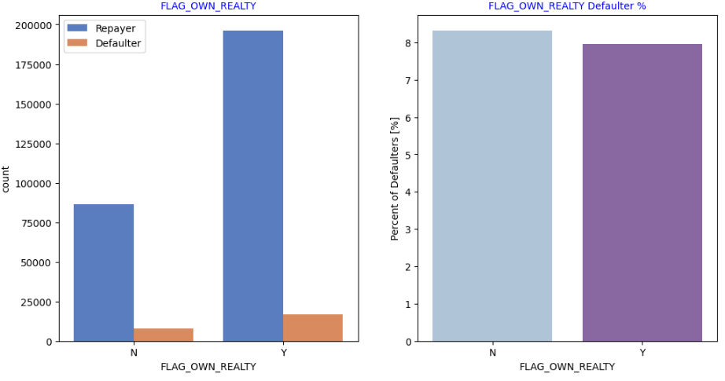
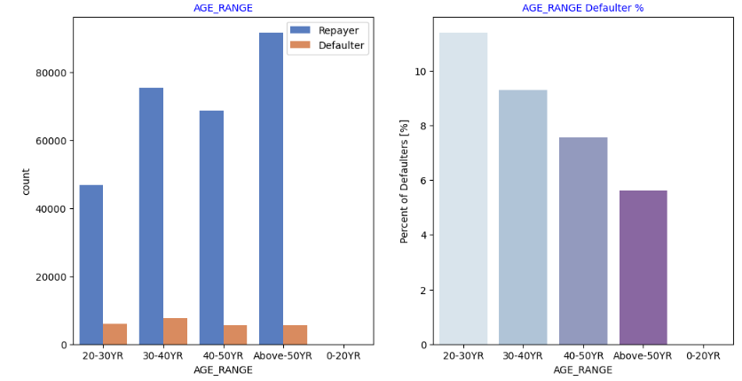

# Loan Defaulter Segmentation & Credit Risk Analysis

## Project Overview

This project explores loan application data to identify borrower characteristics and patterns associated with loan default. Using exploratory data analysis (EDA), data cleaning, and segmentation techniques, the analysis examines demographic, financial, employment, and previous application attributes to uncover insights that can support credit risk assessment and lending decisions.

The goal is to understand which borrower segments may present higher credit risk and how data-driven insights can help financial institutions improve lending strategies.

## Business Problem

Financial institutions need to assess the likelihood that borrowers will repay their loans. Poor risk assessment can increase default rates, financial losses, and operational costs.

This project investigates borrower characteristics and application patterns to identify potential indicators of default and support more informed credit risk management.

## Project Objectives

- Explore borrower demographics, financial information, and employment characteristics.
- Compare repayers and defaulters using relevant borrower attributes.
- Examine missing values, data quality issues, and outliers.
- Segment applicants to identify groups with different default rates.
- Calculate applicant counts and default rates across relevant categories.
- Generate actionable insights to support credit risk assessment and lending decisions.

## Tools and Technologies

| Tool | Purpose |
|---|---|
| Python | Data analysis and processing |
| Pandas | Data manipulation and cleaning |
| NumPy | Numerical computations |
| Matplotlib | Data visualization |
| Seaborn | Statistical visualization |
| Jupyter Notebook | Exploratory analysis and documentation |
| Git and GitHub | Version control and project hosting |

## Dataset Description

The analysis uses the following datasets:

- **`application_data.csv`** — Contains applicant information, including demographic, financial, employment, and loan repayment status attributes.
- **`previous_application.csv`** — Contains information about applicants' previous loan applications.
- **`columns_description.csv`** — Provides descriptions of dataset columns.

### Dataset Availability

The two main datasets, `application_data.csv` and `previous_application.csv`, are not included in this GitHub repository because each file exceeds GitHub's standard 100 MiB limit for individual files.

The datasets remain available locally on the project owner's computer and are excluded from version control through `.gitignore`. The `columns_description.csv` file is included in the repository.

To reproduce the analysis, obtain the original datasets from their source and place them in the project's `data/` directory. The main CSV files must retain the filenames expected by the notebook.

**Note:** Add the original dataset source link here once verified.

## Project Structure

```text
loan-defaulter-segmentation-credit-risk-analysis/
├── data/
│   └── columns_description.csv
├── images/
│   └── repayer vs defaulter.png
├── notebook/
│   └── loan-defaulter_segmentation_analysis_data_honcho_up.ipynb
├── .gitignore
└── README.md
```

## Methodology

### 1. Data Loading and Exploration
- Load the application and previous application datasets.
- Inspect dataset dimensions, column names, and data types.
- Review summary statistics and the distribution of key variables.

### 2. Data Cleaning and Preparation
- Identify missing values and assess their potential impact.
- Investigate outliers and determine appropriate handling methods.
- Remove or retain columns based on their relevance to the analysis, documenting the reasons.
- Prepare variables for meaningful comparisons and segmentation.

### 3. Exploratory Data Analysis
- Examine applicant demographics, financial characteristics, and employment attributes.
- Compare repayers and defaulters across relevant categories.
- Explore relationships between applicant characteristics and the target variable.

### 4. Credit Risk Segmentation
- Group applicants according to selected characteristics.
- Calculate the number of applicants in each group.
- Calculate the percentage of applicants with `TARGET = 1`, representing loan default.
- Compare segment-level default rates while considering group sizes.

### 5. Previous Application Analysis
- Examine historical application information where relevant.
- Review the relationship between the application and previous application datasets.
- Account for multiple previous applications per applicant to avoid unintentionally counting repeat applications as separate borrowers.

## Key Areas of Analysis

- Borrower demographic characteristics
- Employment and income patterns
- Financial and credit-related attributes
- Repayer versus defaulter comparisons
- Applicant segmentation and default rates
- Previous loan application patterns
- Data quality, missing values, and outlier assessment

## Key Findings

The notebook contains the exploratory analysis and visualizations used to investigate potential patterns associated with loan default.

The final findings should highlight the strongest evidence from the analysis, including:

- Applicant segments with relatively higher or lower default rates.
- The number of applicants represented in each segment.
- Relationships between selected borrower characteristics and default outcomes.
- Patterns that may inform further credit risk investigation.

*Specific numerical findings should be added after verifying the results in the notebook.*

## Business Value

The analysis demonstrates how data analytics can help financial institutions:

- Identify borrower segments that may require closer risk assessment.
- Compare default rates across applicant groups.
- Improve the interpretation of borrower and application data.
- Support evidence-based lending policies and credit risk monitoring.
- Develop more focused strategies for managing potential loan defaults.

The results are exploratory and should not be treated as a production-ready credit scoring model or as proof that any single characteristic causes loan default.

## Limitations

- The main datasets are not hosted in this repository because of GitHub file-size restrictions.
- Findings depend on the quality, completeness, and representativeness of the underlying data.
- Exploratory associations do not establish causation.
- Further statistical testing and model validation would be required before using the findings for actual lending decisions.

## Future Improvements

- Add a reproducible environment file such as `requirements.txt`.
- Improve configurable file paths and document the notebook's execution requirements.
- Expand the analysis of applicant counts and default rates across segments.
- Strengthen the treatment of missing values and outliers with documented justifications.
- Review data joins and aggregation logic to ensure that repeat applications do not distort borrower-level results.
- Develop an interactive Power BI dashboard for credit risk monitoring.
- Explore predictive modeling with appropriate validation and performance metrics.

## 📸 Dashboard Preview

### Repayment Status


### Realty vs. No Realty


### Age Range



## How to Run the Project

### 1. Clone the Repository

```bash
git clone https://github.com/data-honcho/loan-defaulter-segmentation-credit-risk-analysis.git
```

### 2. Navigate to the Project Directory

```bash
cd loan-defaulter-segmentation-credit-risk-analysis
```

### 3. Obtain the Required Datasets

Place the following files in the `data/` directory:

```text
data/
├── application_data.csv
├── previous_application.csv
└── columns_description.csv
```

The first two files must be obtained separately from the original dataset source.

### 4. Install the Required Libraries

Install the libraries used by the notebook, if they are not already installed:

```bash
pip install pandas numpy matplotlib seaborn jupyter
```

Additional dependencies may be required depending on the notebook's imports.

### 5. Open the Notebook

Launch Jupyter Notebook:

```bash
jupyter notebook
```

Open:

`notebook/loan-defaulter_segmentation_analysis_data_honcho_up.ipynb`

Run the notebook cells in sequence after confirming that the dataset paths match your local directory structure.

## Author

**David Azorji**

Data Analytics | Exploratory Data Analysis | Credit Risk Analysis

GitHub: [data-honcho](https://github.com/data-honcho)

## Disclaimer

This project is intended for educational and portfolio demonstration purposes. Its findings are exploratory and should not be used as the sole basis for real-world credit approval or lending decisions.